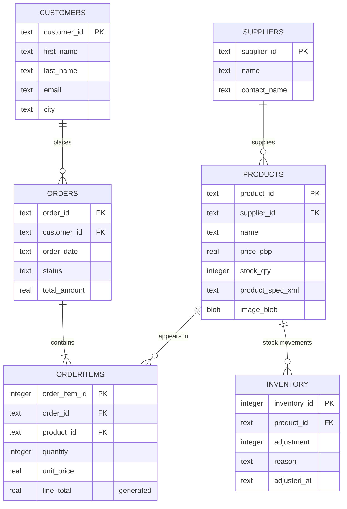
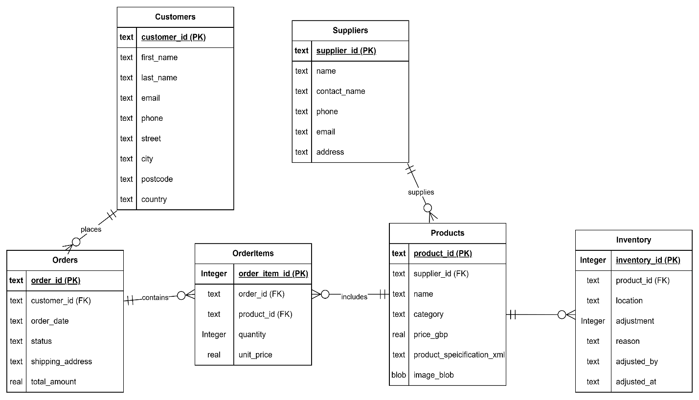
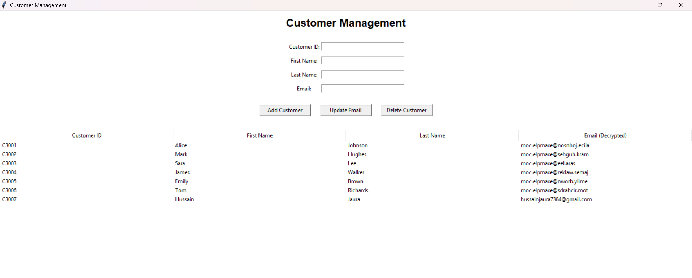
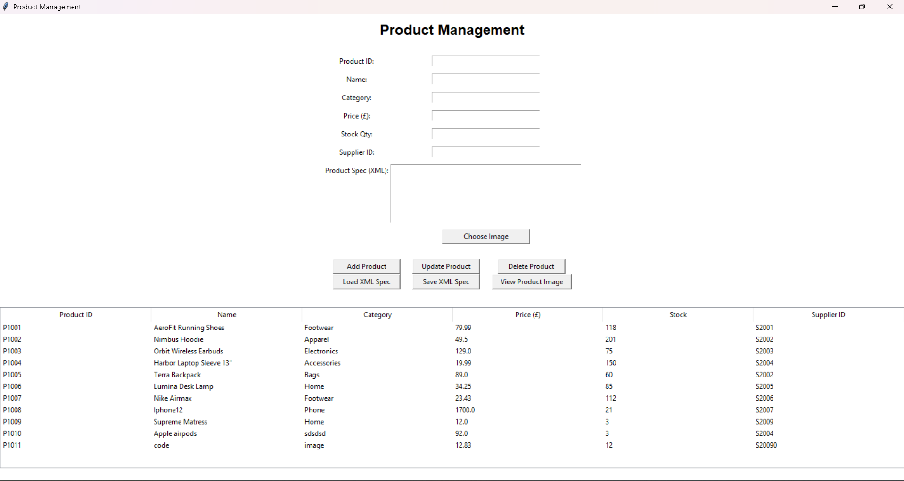
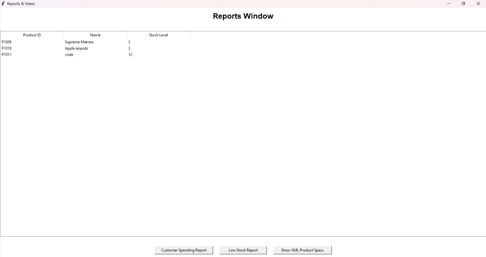

# Online Retail Store: Relational Database Design & Management System


A database for a small online store, designed from business requirements and built in SQLite, with a Python/Tkinter desktop app on top for managing customers, products and reports.

**The focus of this project is the database:** requirements analysis, normalisation to 3NF, an ERD, constraints and referential integrity, triggers, views, custom SQL functions, indexing and testing.

> Built for the COM519 Databases module (BSc Software Engineering).

---

## Highlights

- **Normalised to 3NF** from a flat file, with each step documented → [Database design doc](docs/database-design.md)
- **6 related tables** with primary keys, foreign keys, `CHECK` / `NOT NULL` constraints and deliberate `ON DELETE CASCADE` vs `RESTRICT` choices
- **2 triggers** that keep stock in sync automatically: stock decreases when an item is ordered and is restored when the order is cancelled, and every movement is logged
- **2 views** for business reporting: customer order summary and top-selling products
- **Custom SQL functions** written in Python and registered with SQLite (`fn_order_total`, `fn_stock_level`)
- **Indexes** on JOIN columns, verified with `EXPLAIN QUERY PLAN`
- A **generated column** (`line_total`), **BLOB** image storage and **XML** product specifications
- **Parameterised queries** throughout the app, which protects against SQL injection
- **Runnable SQL tests** for triggers, views, constraints and indexes → [`sql/tests.sql`](sql/tests.sql)

---

## Entity Relationship Diagram



<details>
<summary>Original hand-drawn ERD (crow's foot notation)</summary>



</details>

The complete ERD with every column is in the [design doc](docs/database-design.md#6-from-3nf-to-the-final-erd).

---

## Normalisation, in short

| Stage | What changed |
|---|---|
| **Unnormalised** | One order row with repeating `Product1_…`, `Product2_…`, `Product3_…` columns and customer details copied onto every order. This causes update, insert and delete anomalies. |
| **1NF** | Repeating groups moved into `OrderLines`, with one row per product per order and a composite key `(OrderId, ProductId)`. |
| **2NF** | Partial dependencies removed. `ProductName` depended only on `ProductId`, so product data moved to `Products` and customer data to `Customers`. |
| **3NF** | Checked for transitive dependencies (none found). The core is Customers, Products, Orders and OrderItems. |
| **Final ERD** | Added `Suppliers` and `Inventory` to meet the supplier-management and stock-tracking requirements. |

The full walkthrough, with diagrams and reasoning, is in [**docs/database-design.md**](docs/database-design.md).

---

## Database logic

**Trigger: an order reduces stock automatically**

```sql
CREATE TRIGGER trg_orderitems_after_insert
AFTER INSERT ON OrderItems
BEGIN
    UPDATE Products
    SET stock_qty = stock_qty - NEW.quantity
    WHERE product_id = NEW.product_id;

    INSERT INTO Inventory (product_id, location, adjustment, reason, adjusted_by)
    VALUES (NEW.product_id, 'Online Store', -NEW.quantity,
            'Order ' || NEW.order_id, 'system');
END;
```

A second trigger, `trg_order_cancel_restore_stock`, reverses this when an order's status changes to `Cancelled`.

**Referential integrity choices**

| Relationship | ON DELETE | Reason |
|---|---|---|
| OrderItems → Products | `RESTRICT` | You can't delete a product that appears in past orders, which protects sales history. |
| Products → Suppliers | `RESTRICT` | You can't delete a supplier that still supplies products. |
| Orders → Customers | `CASCADE` | Deleting a customer removes their orders. |
| OrderItems → Orders | `CASCADE` | An order line can't exist without its order. |

**Business queries** ([`sql/queries.sql`](sql/queries.sql)): multi-table JOINs, `GROUP BY … HAVING` to find repeat customers, monthly revenue with `strftime()`, a customer spending ranking, and a low-stock report.

---

## The application

A Tkinter desktop app with three windows:

| Window | Features |
|---|---|
| **Customers** | Add, update and delete customers; input validation; emails stored obfuscated |
| **Products** | Full CRUD; numeric validation; supplier link; upload and view product images (BLOB); edit XML specs, validated before saving |
| **Reports** | Customer spending, low stock (uses the custom `fn_stock_level()` SQL function) and XML spec viewer |

| Customers | Products | Reports |
|---|---|---|
|  |  |  |

🎥 **Demo video:** [Watch on YouTube](https://youtu.be/YOUR-VIDEO-ID)

---

## Project structure

```
├── main.py                  # entry point: main window and navigation
├── db.py                    # shared SQLite connection; registers custom functions
├── function.py              # fn_order_total / fn_stock_level (Python → SQL functions)
├── utils.py                 # image → BLOB helper, email obfuscation helpers
├── windows/
│   ├── customer.py          # customer CRUD window
│   ├── product.py           # product CRUD, images, XML specs
│   └── reports.py           # reports window
├── database/
│   └── online_retail.db     # SQLite database
├── sql/
│   ├── schema.sql           # all tables, constraints, triggers, views, indexes
│   ├── seed.sql             # sample data (from the original flat file)
│   ├── queries.sql          # business queries
│   └── tests.sql            # trigger / view / constraint / index tests
├── scripts/
│   └── rebuild_db.py        # rebuilds the database from schema.sql + seed.sql
├── data/
│   └── flat_file_online_store.xlsx   # original unnormalised business data
└── docs/
    ├── database-design.md   # requirements → normalisation → ERD → implementation
    └── images/              # ERD, normalisation diagrams, screenshots
```

---

## Running it

You need Python 3.10 or later. Tkinter comes with Python on Windows and macOS.

```bash
git clone https://github.com/<your-username>/<repo-name>.git
cd <repo-name>
pip install -r requirements.txt

# optional: rebuild a clean database from the SQL files
python scripts/rebuild_db.py

# start the app (run from the project root)
python main.py
```

To explore the database without the app, open `database/online_retail.db` in [DB Browser for SQLite](https://sqlitebrowser.org/) and run anything from `sql/queries.sql` or `sql/tests.sql`.

---

## Testing

| # | Area | Test | Result |
|---|---|---|---|
| 1 | Trigger | Inserting an order item reduces stock and logs an `Inventory` row | ✅ |
| 2 | Trigger | Cancelling an order restores stock and logs the return | ✅ |
| 3 | Views | Customer summary and top-sellers return correct totals | ✅ |
| 4 | Constraints | Negative quantity or price is rejected (`CHECK`) | ✅ |
| 5 | Constraints | Product with a non-existent supplier is rejected (`FOREIGN KEY`) | ✅ |
| 6 | Constraints | Deleting a product that appears in orders is blocked (`RESTRICT`) | ✅ |
| 7 | Indexes | `EXPLAIN QUERY PLAN` shows `SEARCH … USING INDEX` | ✅ |
| 8 | GUI | Email validation, numeric validation, XML validation, BLOB round-trip | ✅ |

---

## What I'd improve next

- **Real encryption.** Emails are currently obfuscated by reversing the string, which is a placeholder. I'd replace it with proper encryption (e.g. `cryptography.Fernet`) for personal data, and hashing (bcrypt or argon2) for anything like passwords.
- **Money as integers.** Prices are stored as `REAL`, which can produce floating-point results like `319.96000000000004`. I'd store pence as `INTEGER` instead (or use `NUMERIC` in PostgreSQL).
- **One source of truth for stock.** `fn_stock_level()` adds `Inventory` adjustments to `stock_qty`, but the triggers already update `stock_qty`, so movements get counted twice. Either `stock_qty` or the `Inventory` ledger should be the single source.
- **Order totals and cancelled orders.** I'd keep `Orders.total_amount` updated with a trigger (or compute it in the view), and exclude cancelled orders from the spending and top-seller reports.
- **Move to PostgreSQL.** I'd port the schema to use proper types (`NUMERIC`, `TIMESTAMPTZ`, identity columns, `JSONB` instead of XML) and run it with Docker.

---

## Author

**Muhammad Hussain Zaib Jaura**, BSc Software Engineering
[LinkedIn](https://www.linkedin.com/in/muhammad-hussain-jaura-b303482b1/) · [GitHub](https://github.com/hussainjaura/Hussain-Portfolio)
