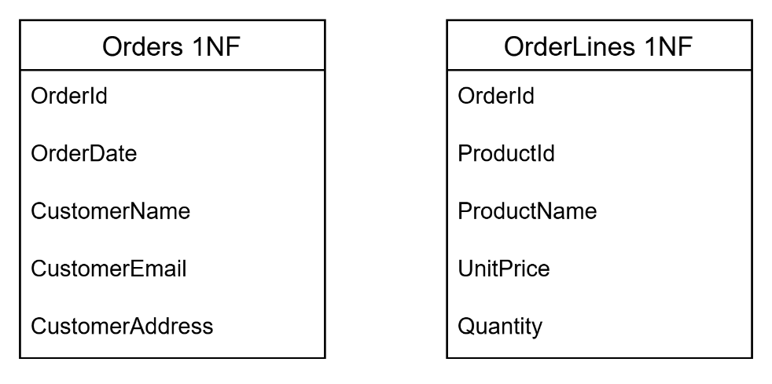
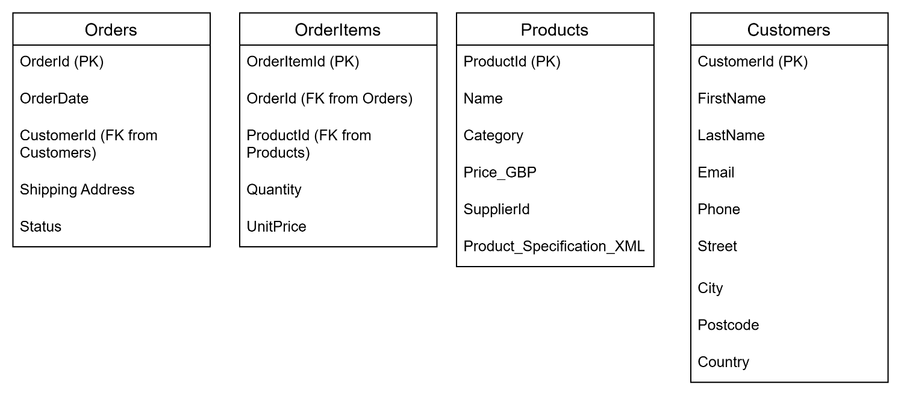
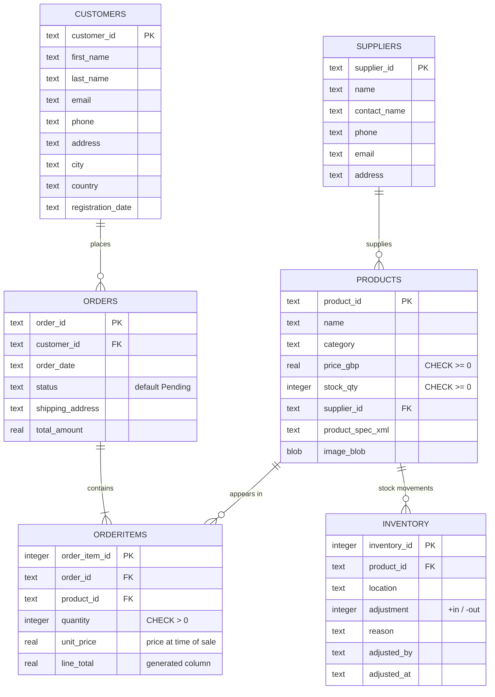

# Database Design: from requirements to schema

This document shows how I went from business requirements, to a flat file, to a normalised (3NF) relational schema, and then to the final SQLite implementation.

---

## 1. Business requirements

The client is a small online store. The database must:

1. Store and manage **customer profiles** (name, contact details, address, registration date).
2. Store **product information** (name, category, price, stock quantity, supplier), plus **product specifications** that differ between product types (stored as XML).
3. Record **orders and order lines**, each linked to a customer, with shipping address, status and timestamps.
4. Keep **inventory** up to date whenever an order is placed or stock is adjusted.
5. Store **supplier information** and record which supplier supplies each product.
6. Support **CRUD** through a GUI, with input validation and protection against SQL injection.
7. Produce **business reports** (customer spending, low stock).

---

## 2. Starting point: the unnormalised order record

The business data started as a flat file ([`data/flat_file_online_store.xlsx`](../data/flat_file_online_store.xlsx)). Modelled as a single order record, it looks like this:

| OrderID | OrderDate | CustomerName | CustomerEmail | CustomerAddress | Product1_ID | Product1_Name | Product1_Price | Product1_Qty | Product2_ID | … | Product3_Qty |
|---|---|---|---|---|---|---|---|---|---|---|---|

**Problems with this design:**

- **Repeating groups.** `Product1_…`, `Product2_…` and `Product3_…` cap an order at three products and leave empty columns for smaller orders.
- **Update anomaly.** If a customer changes their email, every order row for that customer has to be updated, and missing one leaves the data inconsistent.
- **Deletion anomaly.** Deleting the only order that contains a product also deletes everything we knew about that product.
- **Insertion anomaly.** A new product or customer can't be recorded until someone places an order.

---

## 3. First Normal Form (1NF)

**Rules:** no repeating groups, every field holds a single (atomic) value, and every row is uniquely identifiable.

The repeating product columns move into their own relation, with one row per product per order:

| Relation | Primary key |
|---|---|
| Orders (OrderId, OrderDate, CustomerName, CustomerEmail, CustomerAddress) | `OrderId` |
| OrderLines (OrderId, ProductId, ProductName, UnitPrice, Quantity) | `(OrderId, ProductId)`, a composite key |

---

## 4. Second Normal Form (2NF)

**Rule:** the relation is in 1NF, and every non-key attribute depends on the *whole* primary key, not just part of it (no partial dependencies).

In `OrderLines`, the key is `(OrderId, ProductId)`, but:

- `ProductName` depends only on `ProductId`, which is a **partial dependency**.
- `Quantity` and `UnitPrice` depend on the full key, because they describe this product *in this order*.

In `Orders`, the customer details describe the customer, not the order.

**Fix:** move product data into `Products` and customer data into `Customers`, and leave only the line-specific data in `OrderItems`:

`OrderItems` gets a surrogate key (`OrderItemId`) and keeps `OrderId` and `ProductId` as foreign keys.

> **Why `UnitPrice` stays in `OrderItems`:** it isn't a copy of `Products.price_gbp`. It is the price *at the time of sale*. If a product's price changes next month, past orders still show what the customer actually paid.

---

## 5. Third Normal Form (3NF)

**Rule:** the relation is in 2NF, and no non-key attribute depends on another non-key attribute (no transitive dependencies).

I checked each relation:

- **Customers:** name, email, phone and address all depend directly on `customer_id`.
- **Products:** `price_gbp`, `category` and so on depend only on `product_id`. Price doesn't determine category, or the other way round.
- **Orders:** `customer_id` is a foreign key. The customer's details are stored in `Customers`, not repeated here, so there's no transitive dependency.
- **OrderItems:** `quantity` and `unit_price` depend only on the order line.

The four relations (Customers, Products, Orders and OrderItems) are in **3NF**.

---

## 6. From 3NF to the final ERD

Normalisation gives the logical core, but the requirements also call for **supplier management** (requirement 5) and **stock tracking** (requirement 4). So I added two more entities:

| Table | Origin | Purpose |
|---|---|---|
| Customers | From 3NF | Customer profiles |
| Products | From 3NF | Product catalogue, XML specs, images |
| Orders | From 3NF | Order header |
| OrderItems | From 3NF | Order lines; resolves the many-to-many relationship between Orders and Products |
| Suppliers | Added after 3NF | Supplier management requirement |
| Inventory | Added after 3NF | Audit log of every stock movement (written by triggers) |

### Original ERD (drawn during design)

### ERD of the implemented schema

The diagram below is generated from [`sql/schema.sql`](../sql/schema.sql). It differs slightly from the drawn ERD: the implemented `Customers` table uses `address` instead of `street`/`postcode` and adds `registration_date`, and `Products` has a `stock_qty` column.

---

## 7. Referential integrity and design decisions

| Relationship | ON DELETE | Why |
|---|---|---|
| Orders → Customers | `CASCADE` | Deleting a customer removes their orders. |
| OrderItems → Orders | `CASCADE` | An order line can't exist without its order. |
| OrderItems → Products | `RESTRICT` | You can't delete a product that appears in past orders, which protects sales history. |
| Products → Suppliers | `RESTRICT` | You can't delete a supplier that still supplies products. |
| Inventory → Products | `CASCADE` | Stock logs belong to their product. |

All foreign keys use `ON UPDATE CASCADE`, so changing a key value propagates to every row that references it.

**Other decisions**

- **`CHECK` constraints** on `price_gbp`, `stock_qty`, `quantity` and `unit_price` stop negative or zero values at the database level, not just in the GUI.
- **`line_total` is a generated column** (`quantity * unit_price`), so it can never disagree with its inputs.
- **Product specifications are stored as XML** because attributes differ by product type (shoes have sizes, earbuds have battery life). A fixed column per attribute would mean many mostly-empty columns. The app validates the XML with `ElementTree` before saving it.
- **Images are stored as `BLOB`s** in `Products.image_blob`, so the database is self-contained.
- **Inventory is an append-only log.** Triggers write to it, so every stock movement has a reason and a timestamp.
- **Text IDs** (`C3001`, `P1001`) match the IDs in the original flat file. `OrderItems` and `Inventory` use auto-incrementing integer keys because they are internal rows.

---

## 8. Database logic

### Triggers

| Trigger | Fires on | What it does |
|---|---|---|
| `trg_orderitems_after_insert` | `AFTER INSERT ON OrderItems` | Decreases `Products.stock_qty` and writes a negative `Inventory` entry, e.g. "Order O4001". |
| `trg_order_cancel_restore_stock` | `AFTER UPDATE OF status ON Orders` when the status becomes `'Cancelled'` | Adds every line's quantity back to stock and writes a positive `Inventory` entry, e.g. "Order O4001 cancelled". |

### Views

| View | Answers |
|---|---|
| `vw_customer_order_summary` | For each customer: how many orders, total spent, and most recent order date. Uses a `LEFT JOIN`, so customers with no orders still appear. |
| `vw_top_selling_products` | Units sold and revenue per product, best seller first. |

### Custom SQL functions (registered from Python)

SQLite doesn't support stored functions, so these are written in Python and registered with `conn.create_function()`. After that they can be called inside SQL, for example `SELECT ... WHERE fn_stock_level(product_id) < 20`.

| Function | Returns |
|---|---|
| `fn_order_total(order_id)` | `SUM(quantity * unit_price)` for the order |
| `fn_stock_level(product_id)` | Current stock level of the product |

### Indexes

`idx_orderitems_order` and `idx_orderitems_product` index the foreign-key columns used in every order/product JOIN. `EXPLAIN QUERY PLAN` confirms that SQLite uses them (`SEARCH OrderItems USING INDEX idx_orderitems_order`) instead of scanning the whole table.

---

## 9. Testing

See [`sql/tests.sql`](../sql/tests.sql) for the runnable tests. They cover:

- **Triggers:** stock goes down when an item is ordered and back up when the order is cancelled, and both movements are logged in `Inventory`.
- **Views:** both views return the correct totals.
- **Constraints:** a negative quantity, a negative price, a non-existent supplier, and deleting a product that has orders are all rejected.
- **Indexes:** the query plan uses the index.
